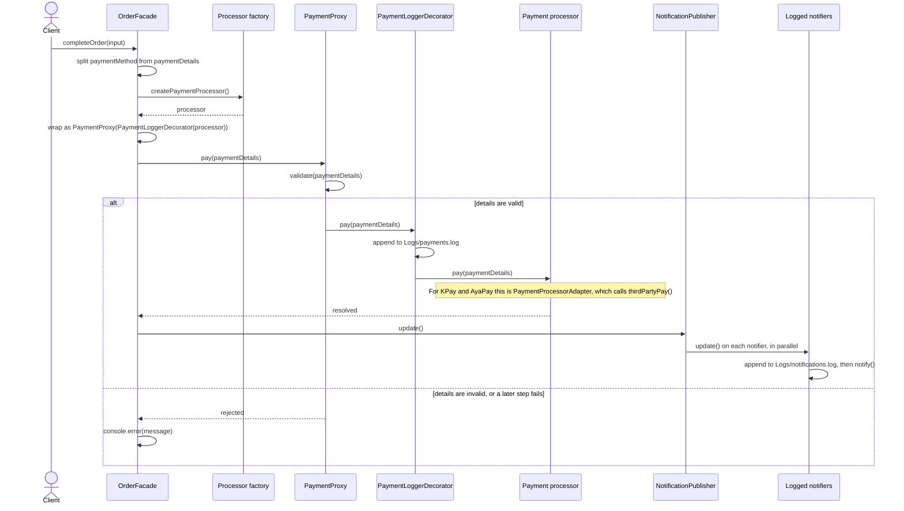
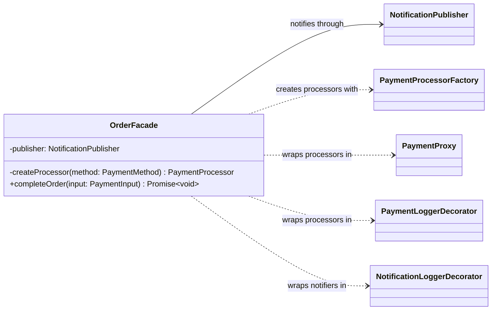
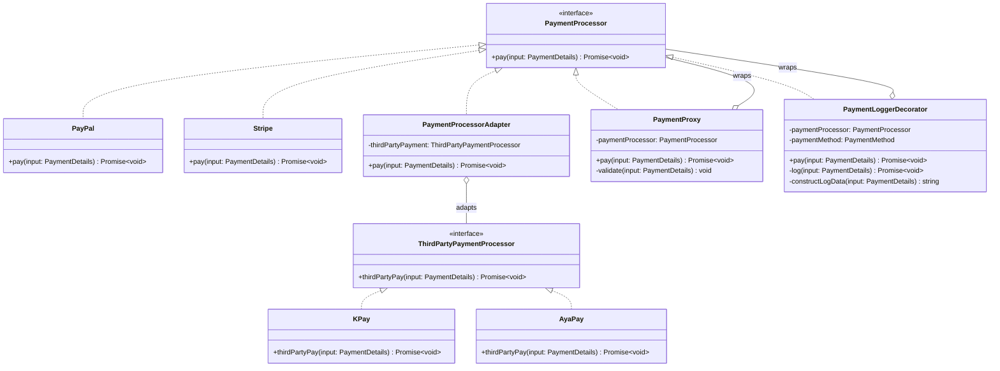
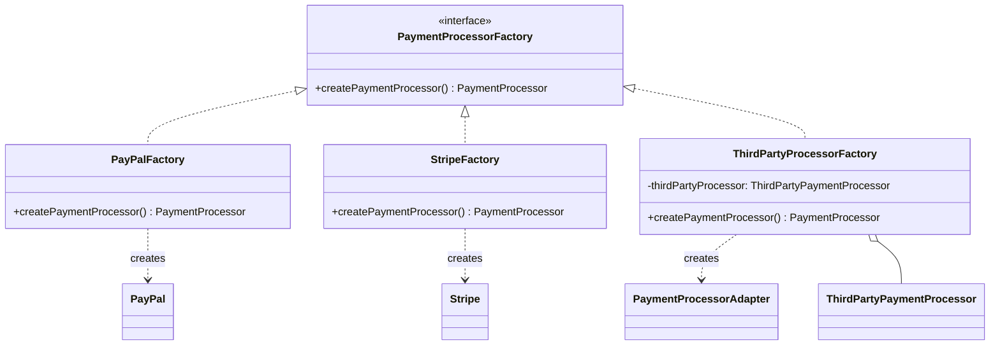
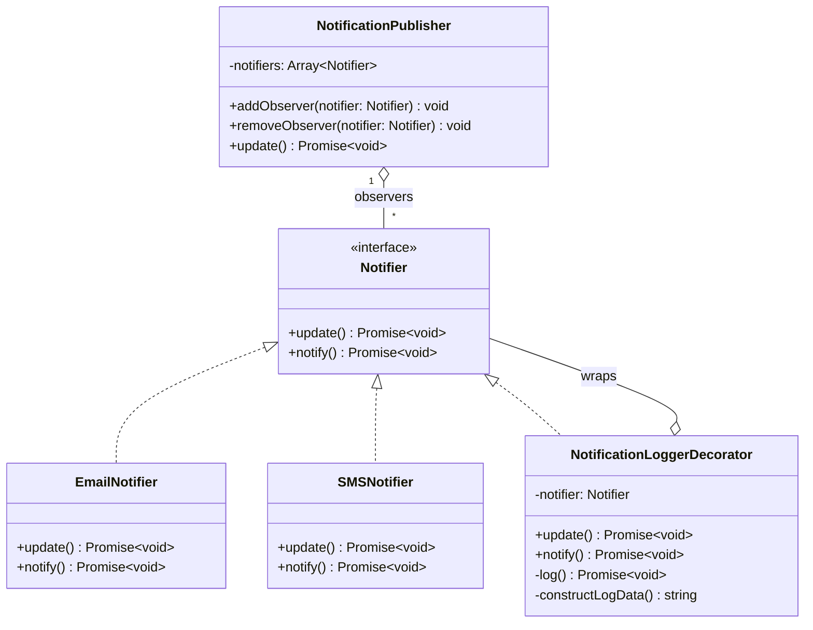
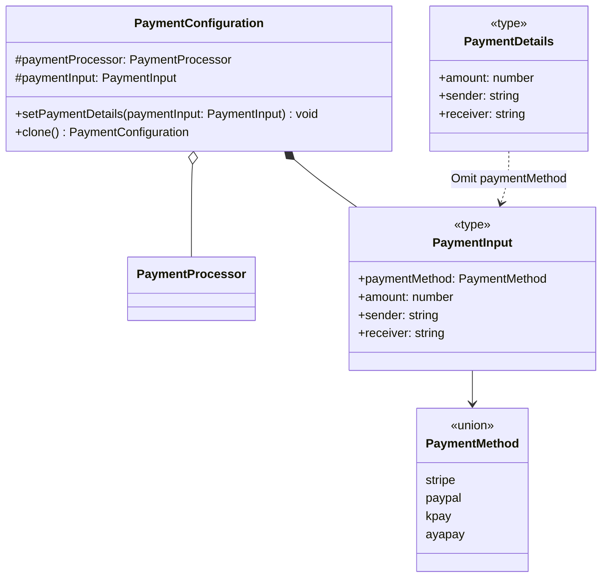

# PatternHub

PatternHub is a TypeScript project that shows how classic design patterns work together in one order-payment flow. A client completes an order through a single facade. The order is paid through one of four payment providers, and the customer is then notified by email and SMS. A different pattern handles each step.

The payment providers and notifiers are simulated. They print to the console instead of calling real services.

## Setup

### Requirements

- Node.js 22.18 or later. These versions run `.ts` files directly, so there is no build step. The project is developed on Node 24.
- npm, to install TypeScript for type-checking.

### Install

```sh
git clone https://github.com/ShinThantNaung/PatternHub.git
cd PatternHub
npm install
mkdir Logs
```

Create `Logs/` before running anything. The logging decorators append to `Logs/payments.log` and `Logs/notifications.log`, but they don't create the folder. Git ignores `Logs/`, so a fresh clone doesn't have it. The log paths are relative to the working directory, so run commands from the project root.

### Commands

| Command | What it does |
| --- | --- |
| `npm run dev` | Runs the demo in `src/index.ts`. |
| `npm test` | Runs the tests in `tests/` with the Node.js test runner. |
| `npx tsc` | Type-checks the project and the tests. It emits no files. |

The demo sends an invalid amount (`-3`) on purpose, so its expected output is the proxy's validation error:

```text
An unexpect error occurred: Payment amount must be a finite value greater than zero
```

Change `amount` in `src/index.ts` to a positive number to see a successful order.

The tests use only `node:test` and `node:assert`, with no extra dependencies. Tests that write logs run in a temporary directory, so they never touch your `Logs/` folder.

> [!NOTE]
> Node runs the source without compiling it, so the code can only use TypeScript syntax that Node can strip away. Don't use `enum`, `namespace`, or constructor parameter properties such as `constructor(private readonly processor: PaymentProcessor)`. With the current configuration, `npx tsc` doesn't flag these; Node fails when it runs the file.

## Usage

```ts
import { OrderFacade } from "./src/Structural/Facade/OrderFacade.ts";

const orders = new OrderFacade();

await orders.completeOrder({
  paymentMethod: "kpay", // "stripe" | "paypal" | "kpay" | "ayapay"
  amount: 25,
  sender: "Alice",
  receiver: "Bob",
});
```

Console output:

```text
Processing payment of 25$ from Alice to Bob with KPay third party api...
Customer has been notified via email
Customer has been notified via SMS
```

The email and SMS notifications run in parallel, so they can print in either order.

Each order also appends an entry to `Logs/payments.log`:

```text
2026-10-21T03:15:42.120Z
From: Alice
To: Bob
Amount: 25
Via: kpay
```

Each notifier adds a `Notification sent at <timestamp>` line to `Logs/notifications.log`.

`completeOrder()` doesn't throw when the payment or a notification fails. It prints the error with `console.error` instead. If the payment fails, no notifications are sent. One exception is listed under [Other limitations](#other-limitations).

## Operation flow

1. **Facade.** The client calls `OrderFacade.completeOrder()` with a `PaymentInput`. The facade splits off `paymentMethod`. The rest, `PaymentDetails` (amount, sender and receiver), is all a payment processor receives.
2. **Factory.** The facade uses `paymentMethod` to pick a factory. `PayPalFactory` and `StripeFactory` create direct processors. `ThirdPartyProcessorFactory` handles KPay and AyaPay.
3. **Adapter.** KPay and AyaPay expose `thirdPartyPay()` instead of `pay()`. `ThirdPartyProcessorFactory` wraps them in `PaymentProcessorAdapter` so they fit the common `PaymentProcessor` interface.
4. **Proxy, then Decorator.** The facade wraps the processor as `PaymentProxy` → `PaymentLoggerDecorator` → processor. The proxy validates the details, the decorator logs them, and then the processor pays.
5. **Observer.** After a successful payment, `NotificationPublisher.update()` notifies every registered notifier in parallel and waits for all of them.
6. **Decorator.** Each notifier is wrapped in `NotificationLoggerDecorator`, which logs the notification before email or SMS delivery.



## Which pattern meets which requirement

| Requirement | Pattern | Implementation |
| --- | --- | --- |
| Clients complete an order with one call, without knowing which classes are involved. | Facade | [`OrderFacade`](src/Structural/Facade/OrderFacade.ts) |
| The facade gets the right processor for a payment method without constructing concrete classes itself. | Factory | [`PaymentProcessorFactory`](src/Creational/Factory/Factories/PaymentProcessorFactory.ts), implemented by `PayPalFactory`, `StripeFactory` and `ThirdPartyProcessorFactory` |
| Third-party providers whose API (`thirdPartyPay()`) doesn't match `PaymentProcessor` can still be used. | Adapter | [`PaymentProcessorAdapter`](src/Structural/Adaptor/PaymentProcessorAdaptor.ts) |
| Invalid amounts and blank names are rejected before any processor runs. | Proxy | [`PaymentProxy`](src/Structural/Proxy/PaymentProxy.ts) |
| Payments and notifications are logged without changing the classes that do the work. | Decorator | [`PaymentLoggerDecorator`](src/Structural/Decorator/PaymentLoggerDecorator.ts), [`NotificationLoggerDecorator`](src/Structural/Decorator/NotificationLoggerDecorator.ts) |
| Several channels are notified after a payment, and new channels don't require changes to the publisher. | Observer | [`NotificationPublisher`](src/Behavioural/Observer/NotificationPublisher.ts), with `EmailNotifier` and `SMSNotifier` as observers |
| A payment configuration can be copied instead of rebuilt. | Prototype | [`PaymentConfiguration.clone()`](src/Creational/Prototype/PaymentConfiguration.ts) |

Each pattern folder under `src/` has its own README with more detail.

### Extending the project

| To add | Change |
| --- | --- |
| A direct payment provider | Implement `PaymentProcessor` and a matching `PaymentProcessorFactory`. Add the method name to `PaymentMethod` in `src/Types/PaymentInput.ts` and to the copy of that type in `PaymentLoggerDecorator.ts`. Then add a `case` to `OrderFacade.createProcessor()`. |
| A third-party provider | Implement `ThirdPartyPaymentProcessor`. Add the method name to both `PaymentMethod` types, and add a `case` that passes the provider to `ThirdPartyProcessorFactory`. |
| A notification channel | Implement `Notifier`, then register it in the `OrderFacade` constructor, wrapped in `NotificationLoggerDecorator`. |

## Class diagrams

### Order facade



### Payment processing



### Processor creation



### Notifications



### Prototype and shared types



`PaymentDetails` is defined as `Omit<PaymentInput, "paymentMethod">`. All three types live in [`src/Types/PaymentInput.ts`](src/Types/PaymentInput.ts).

## Known limitations

### Patterns that are not implemented

- **Singleton.** It's treated as an antipattern in TypeScript. An ES module is evaluated only once, so exporting a shared instance from a module already guarantees a single instance. A Singleton class adds hidden global state and is harder to replace in tests.
- **Strategy.** Processor selection stays a `switch` in `OrderFacade.createProcessor()`. Turning each case into a strategy class would add more subclasses and complexity without being any more convenient than the `switch`.
- **Command.** Nothing needs a layer in front of the facade. Adding one would make clients create extra classes only to have their call redirected to `OrderFacade.completeOrder()`.

### Other limitations

- The payment providers and notifiers are simulated with `console.log`. Nothing calls a real API.
- `Logs/` must exist. If it's missing, the payment fails with `ENOENT`, the facade reports the error, and no notifications are sent.
- An unknown payment method makes `completeOrder()` throw `Unknown payment method` instead of reporting the error, because the processor is created before the `try` block. TypeScript callers can't pass one, but untyped input from JavaScript or JSON can.
- `OrderFacade` doesn't use `PaymentConfiguration`. It's a standalone example of `clone()`.

## Project structure

```text
src/
  index.ts                    Demo entry point
  Types/PaymentInput.ts       PaymentInput, PaymentDetails and PaymentMethod
  Payment/
    PaymentProcessors/        PaymentProcessor interface, PayPal, Stripe
    Third-Party/              ThirdPartyPaymentProcessor interface, KPay, AyaPay
  Notifiers/                  Notifier interface, EmailNotifier, SMSNotifier
  Creational/
    Factory/                  Processor factories
    Prototype/                PaymentConfiguration
  Structural/
    Adaptor/                  PaymentProcessorAdapter
    Decorator/                Payment and notification loggers
    Facade/                   OrderFacade
    Proxy/                    PaymentProxy
  Behavioural/
    Observer/                 NotificationPublisher
tests/                        Test suites, laid out like src/
  helpers/                    Fakes and a temporary Logs/ workspace
```
